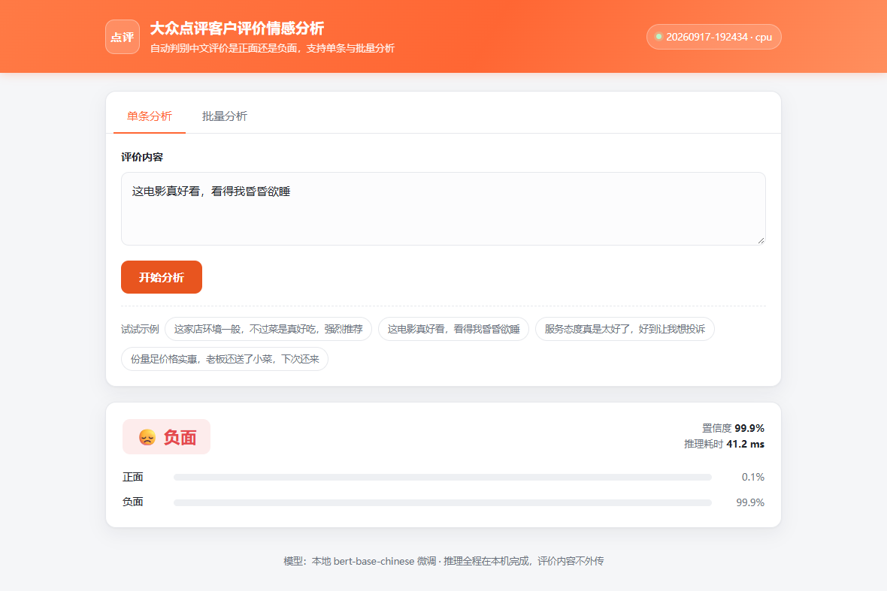
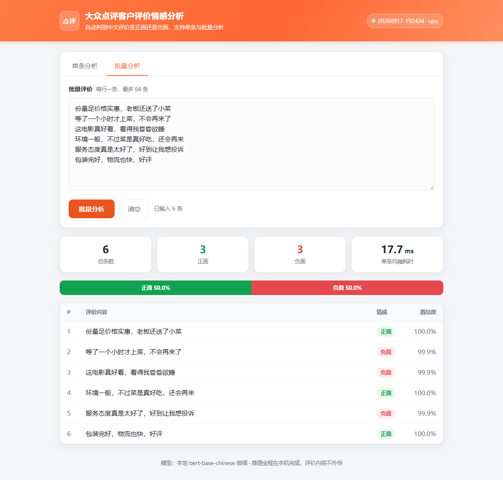

# 大众点评客户评价情感分析

## 项目介绍

基于 `bert-base-chinese` 微调的中文评价情感分析项目，用于识别用户评价的正负面倾向，提供 Web 页面和 REST API，支持通过 Docker 部署。

模型为二分类：`0=负面`、`1=正面`，不包含中性标签。当前训练数据由模板合成，模型效果需结合真实业务数据进一步评估。

## 主要特性

- **单条分析**：返回情感标签、置信度和分类概率。
- **批量分析**：按输入顺序返回结果，统计正负面数量及占比。
- **模型训练**：支持数据生成、BERT 微调、评估和训练记录保存。
- **服务部署**：模型启动时加载并预热，支持模型版本配置和容器健康检查。

## 项目结构

```text
bert_finetune/
├── src/dianping_sentiment/
│   ├── data.py                  # 数据生成与加载
│   ├── train.py                 # 模型训练
│   ├── evaluate.py              # 模型评估
│   ├── model.py                 # 模型加载与推理
│   ├── service.py               # Web 页面与 API
│   ├── config.py                # 配置管理
│   ├── templates/              # 页面模板
│   └── static/                 # 前端资源
├── scripts/cli.py              # 命令行入口
├── config.yaml                 # 训练与服务配置
├── pyproject.toml / uv.lock     # 项目依赖
├── Dockerfile                  # 镜像构建
├── docker-compose.yml          # 本地构建与运行
├── docker-compose.deploy.yml   # 云端镜像部署
├── .env.example                # 部署配置示例
├── data/                       # 训练数据与测试集
├── tests/                      # 自动化测试
├── docs/                       # 示例截图
├── bert-base-chinese/          # 预训练权重，仅训练需要
├── models/                     # 训练好的模型
└── runs/                       # 训练日志与指标
```

## 技术栈

| 层级 | 技术 |
|---|---|
| 模型训练与推理 | Python 3.12、PyTorch CPU、Transformers、scikit-learn |
| 后端服务 | Flask、Waitress |
| 前端页面 | HTML、CSS、JavaScript |
| 依赖与部署 | uv、Docker、Docker Compose |

## 示例图

单条评价分析：



批量评价分析：



## Docker 部署方法

先准备训练好的模型，放入 `models/<模型版本>/`。仓库和镜像均不包含模型权重，运行时通过目录挂载加载完整模型及分词器文件。

### 本地构建与启动

安装 Docker 和 Docker Compose，在项目根目录执行：

```bash
docker compose build api
docker compose up -d --no-build api
```

访问 [http://127.0.0.1:8000](http://127.0.0.1:8000)。仅运行容器时，宿主机无需安装 Python 或 uv。

### 云服务器部署

将镜像推送到镜像仓库，服务器准备 `docker-compose.deploy.yml`、`config.yaml` 和完整的 `models/` 目录。在同目录创建 `.env`，填写实际镜像地址和模型版本：

```dotenv
DS_IMAGE=registry.example.com/your-project/dianping-sentiment:版本
DS_MODEL_DIR=/app/models/20260917-192434
DS_PORT=8000
DS_BIND_ADDRESS=0.0.0.0
```

```bash
docker compose -f docker-compose.deploy.yml pull api
docker compose -f docker-compose.deploy.yml up -d --no-build api
docker compose -f docker-compose.deploy.yml ps
```

放行服务器 8000 端口后，访问 `http://服务器IP:8000`。如果镜像已经通过 `docker load` 导入，可跳过 `pull`；只部署推理服务不需要下载 `bert-base-chinese` 或重新训练。

查看日志使用 `docker compose -f docker-compose.deploy.yml logs -f api`。修改挂载配置后重启服务，切换模型时修改 `.env` 并重新执行 `up`；日常启动无需重新构建镜像。
